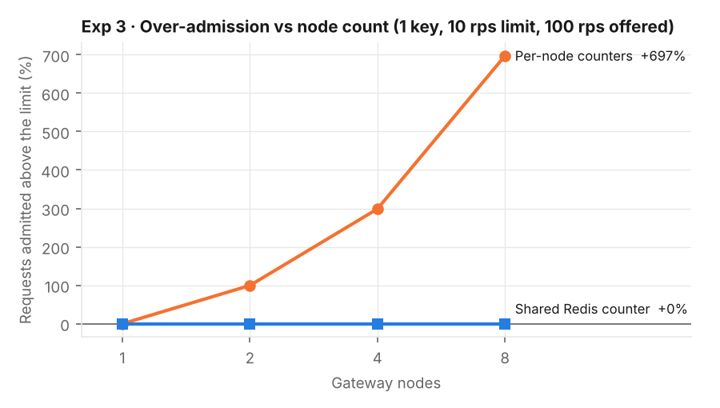
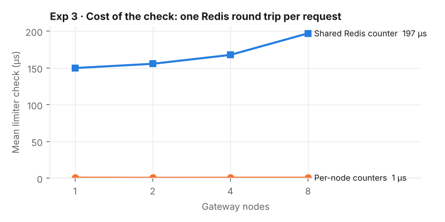

# Experiment 3 — Rate limiter accuracy across nodes

Owner: Saravjit · Issue #19 · Course concept: **consistency models**
Status: **preliminary, local** (Nov 25). To be repeated on ECS once the AWS stack (#21, #22) exists.

## Question
With N gateway nodes, does a key limited to L requests get L in total (one
strongly consistent counter in Redis) or up to N × L (a separate counter on each
node)? What does the shared check cost?

## Setup (as run)
| | |
|---|---|
| Machine | one 4-vCPU Linux container; every process on localhost |
| Gateway | 1, 2, 4, 8 real `cmd/gateway` processes, requests sent round-robin (stands in for the ALB) |
| Redis | Redis 7.0.15, local `redis-server` |
| Limit | one API key, **600/min (10 rps), burst 10** → allowed in 30 s = 10 + 10 × 30 = **310** |
| Load | **100 rps for 30 s**, open loop (`experiments/tools/loadgen`), 3,000 requests per run |
| Isolation | provider never limits (mock, 20 ± 5 ms), cache off, queue off, budgets unlimited: only the limiter decides |
| Repeats | 3 per configuration (24 runs) |

Reproduce: `REDIS_ADDR=localhost:6379 ./experiments/03-ratelimit/run.sh`, then `python3 experiments/tools/charts.py 3`.

## Results
Admitted requests were **identical in all 3 repeats** of every configuration.

| Nodes | Per-node counters: admitted | Over-admission | Shared Redis: admitted | Over-admission |
|---|---|---|---|---|
| 1 | 309 | −0.3% | 309 | −0.3% |
| 2 | 618 | **+99%** | 309 | −0.3% |
| 4 | 1,236 | **+299%** | 309 | −0.3% |
| 8 | 2,472 | **+697%** | 309 | −0.3% |

| Nodes | Limiter check, per-node (mean) | Limiter check, Redis (mean, range over repeats) | End-to-end p50 / p99, Redis |
|---|---|---|---|
| 1 | 0.9 µs | 150 µs (147–156) | 21.7 / 26.3 ms |
| 2 | 0.7 µs | 156 µs (149–165) | 21.4 / 26.9 ms |
| 4 | 0.8 µs | 168 µs (149–197) | 21.4 / 26.5 ms |
| 8 | 0.9 µs | 197 µs (171–232) | 22.1 / 26.6 ms |

(Per-node counters' end-to-end latency was 21.2–21.7 ms p50 and 26.4–26.5 ms p99: the same within noise.)

## What it shows
1. **Per-node counters over-admit by exactly (N − 1) × 100%.** Each node sees 1/N of
   the traffic and enforces the full limit on its share, so the key gets N × L.
   With 8 nodes a customer paying for 10 rps got 80 rps. This is the cost of the
   weaker consistency model: each node's view of "how much has this key used" is
   only its own.
2. **The shared Redis counter holds the limit exactly at every node count** (309
   of 310 allowed; the last request is sent at t = 29.99 s, just before the
   310th token refills at t = 30 s). The token bucket runs as one atomic Lua script using Redis's clock, so
   concurrent nodes can't double-spend a token and clock skew can't matter.
3. **The price is one Redis round trip per request: ~0.15–0.2 ms here**, about
   200× the in-process check but under 1% of the 21 ms end-to-end request, and
   tiny next to a real LLM call (~1 s). It grows with node count (150 → 197 µs) as
   more processes compete for one Redis and, here, for the same 4 CPUs.

## Caveats
- **Local, not AWS.** All processes shared 4 CPUs, so the latency growth with
  node count mixes Redis contention with CPU contention. On ECS (separate tasks,
  ElastiCache in the same AZ) expect a higher base (~0.5–1 ms network round trip)
  and a flatter curve.
- Round-robin across nodes is the best case for per-node counters being "fair";
  a skewed balancer would make their over-admission uneven per node but the total
  stays up to N × L.
- One hot key. The plan's hot-key vs 1,000-keys test (does a single Redis key
  become a bottleneck?) is not run yet.

## Left to do (Week 3)
- [ ] Repeat on ECS with 1/2/4/8 tasks behind the ALB and ElastiCache (needs #21, #22).
- [ ] Hot key vs 1,000 keys at the same total load.
- [ ] Optional: local counters synced periodically to Redis (the middle ground) to plot over-admission vs sync interval.
