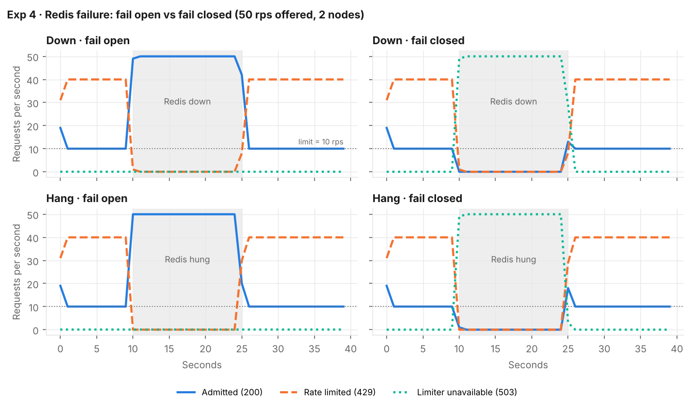

# Experiment 4 (stretch) — Redis failure: fail open vs fail closed

Owner: Saravjit · Issue #19 · Course concept: **CAP and partitions**, **failure models**
Status: **preliminary, local** (Nov 25), 1 run per case.

## Question
When the shared rate-limit state (Redis) becomes unreachable, the limiter must
choose: **fail open** (keep serving, limits not enforced: available) or **fail
closed** (reject, limits never exceeded: consistent). What does each choice cost,
and how fast does the gateway recover?

## Setup (as run)
| | |
|---|---|
| Machine | one 4-vCPU Linux container; every process on localhost |
| Gateway | 2 `cmd/gateway` processes, round-robin; limiter `RATELIMIT_BACKEND=redis`, 50 ms per-call budget |
| Limit | one API key, 10 rps (600/min), burst 10 → **410 allowed** in 40 s |
| Load | **50 rps for 40 s** (2,000 requests), open loop |
| Isolation | only the limiter uses Redis: cache off, queue off, budgets in memory; mock provider 20 ± 5 ms |
| Faults | **down:** Redis process stopped at t = 10 s, restarted at t = 25 s (connections refused) |
| | **hang:** `CLIENT PAUSE 15000` at t = 10 s (Redis accepts but never answers until t = 25 s) |

Reproduce (local only; it restarts the Redis it points at):
`REDIS_ADDR=localhost:6379 ./experiments/04-redis-failure/run.sh`, then `python3 experiments/tools/charts.py 4`.

## Results
| Fault | Fail mode | Admitted (of 2,000) | Allowed by the limit | Let through during the 15 s fault | 503 | 429 | p99 | Max latency |
|---|---|---|---|---|---|---|---|---|
| down | **open** | 1,040 | 410 | **749 of 750** | 0 | 960 | 77 ms | 84 ms |
| down | **closed** | 262 | 410 | 0 | **778** | 960 | 26 ms | 55 ms |
| hang | **open** | 1,019 | 410 | **750 of 750** | 0 | 981 | 77 ms | 79 ms |
| hang | **closed** | 268 | 410 | 1 | **752** | 980 | 29 ms | 76 ms |

Per second, at the edges of the fault (admitted / 429 / 503):

| t (s) | down · open | down · closed | hang · open | hang · closed |
|---|---|---|---|---|
| 9 (before) | 10 / 40 / 0 | 10 / 40 / 0 | 10 / 40 / 0 | 10 / 40 / 0 |
| 10 (fault starts) | 49 / 1 / 0 | 0 / 1 / 49 | 50 / 0 / 0 | 1 / 0 / 49 |
| 25 (Redis back) | 42 / 8 / 0 | 13 / 8 / 29 | 20 / 30 / 0 | 18 / 29 / 3 |
| 26 (after) | 10 / 40 / 0 | 10 / 40 / 0 | 10 / 40 / 0 | 10 / 40 / 0 |

## What it shows
1. **The CAP trade-off, in numbers.** Over a 15 s Redis outage:
   - **Fail open** stayed fully available and let through **all 750 requests**,
     **5× the 150 the limit allows** in that window. A client that was being
     limited to 10 rps got 50 rps.
   - **Fail closed** never exceeded the limit, but rejected **every** request with
     503, including the ~150 the client was entitled to. Over the whole run it
     admitted only 262 of the 410 allowed.
2. **Both modes react within one second and recover within one second.** The
   switch happened in the first second of the fault, and the second after Redis
   returned was back to exactly 10 admitted / 40 limited. No restart needed:
   the go-redis client reconnects on its own.
3. **A hung Redis is contained by the 50 ms deadline.** With `CLIENT PAUSE`
   (Redis accepts connections but never replies, the nastiest case) the worst
   request took 79 ms. Without the context deadlines from the shared client (#35)
   a call would block for go-redis's 3 s read timeout. Fail-open p99 rose from
   ~26 ms to 77 ms because each request spends up to the 50 ms budget before giving up.
4. **Found: a refused connection is not "fast".** In the *down* case requests
   also waited ~50 ms (p99 77 ms) even though the connection was refused at once.
   The likely cause (not yet confirmed) is go-redis retrying failed commands
   (default 3 retries with backoff) until the deadline. Setting `MaxRetries` lower for the limiter, or a circuit breaker
   that skips Redis for a moment after repeated failures, would make the down
   case fail in ~1 ms. Worth a small follow-up with Dinesh (`internal/redisx`).

## Which mode should the gateway use?
It depends on what the limit protects:
- **Per-key rate limits → fail open (our default).** An outage of the limiter
  should not become an outage of the product; the provider's own limits and the
  queue's pacer still bound total traffic.
- **Budgets or hard cost caps → consider fail closed**, where overspending is worse
  than refusing requests. Both components expose the choice
  (`RATELIMIT_FAIL_MODE`, `BUDGET_FAIL_MODE`).

## Caveats
- Local and 1 run per case. Redis restart on localhost takes milliseconds; on AWS
  a failover of ElastiCache takes tens of seconds, which this doesn't model.
- On AWS, Redis can't be killed from the test; block the ElastiCache security group
  instead (closer to a network partition than a crash).

## Left to do
- [ ] 3 runs per case; on ECS with a security-group block (needs #21).
- [ ] Try the `MaxRetries` / short-circuit change and re-measure the *down* case.
