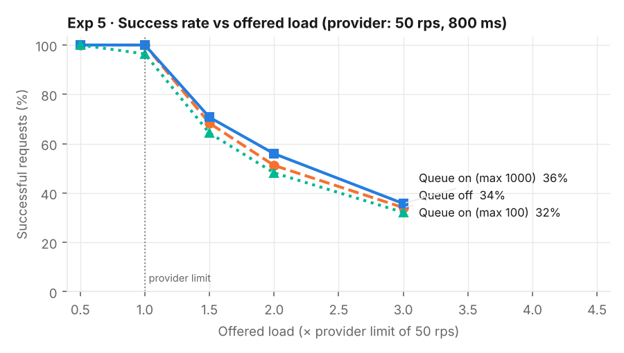
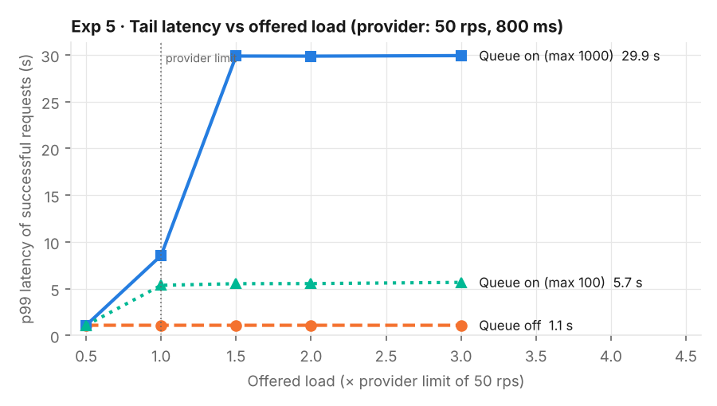
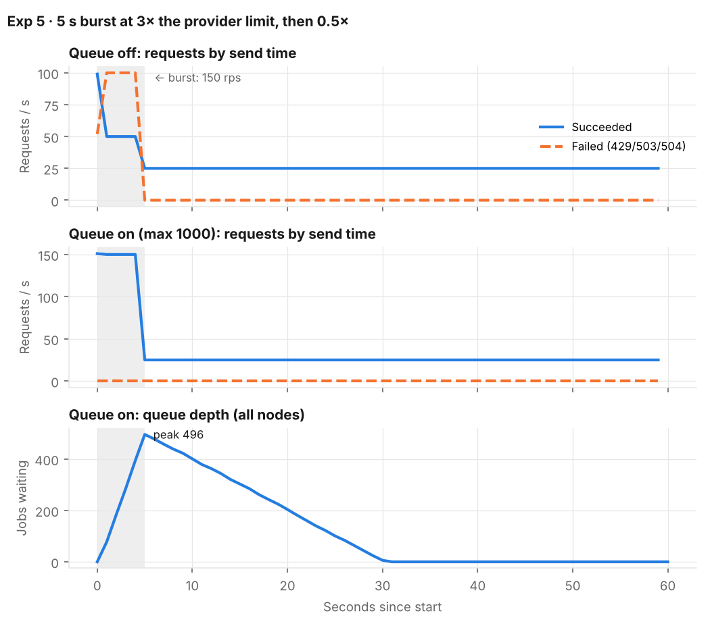
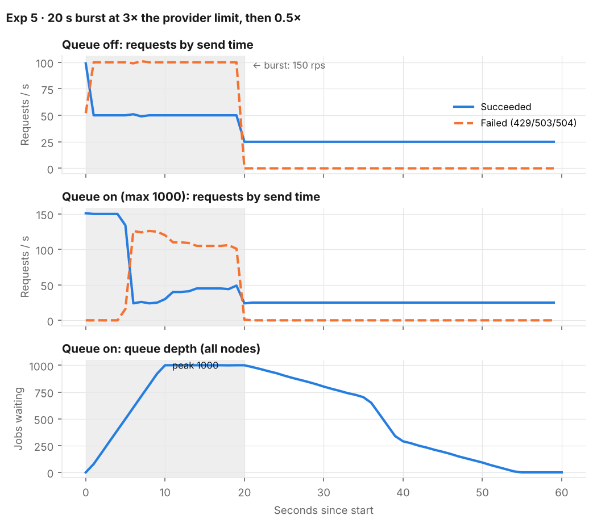

# Experiment 5 — Queueing under provider rate limits

Owner: Saravjit · Issue #19 · Course concept: **asynchronous messaging and backpressure**
Status: **preliminary, local** (Nov 25). To be repeated on ECS once the AWS stack (#21, #22) exists.

## Question
When offered load exceeds the provider's rate limit, how much does the overflow
queue help, what does it cost in latency, and where does backpressure kick in?

## Setup (as run)
| | |
|---|---|
| Machine | one 4-vCPU Linux container; every process on localhost |
| Provider | mock LLM, **limit 50 rps** (excess gets 429), latency **800 ± 300 ms** |
| Gateway | 2 `cmd/gateway` processes, round-robin; Redis 7 shared |
| Queue | Redis Streams (#40); provider pacer shared through Redis at **45 rps**; wait timeout **30 s** |
| Configs | **off** (429s go to the client), **on, max 1000**, **on, max 100** |
| Load | open loop (`experiments/tools/loadgen`), 50 API keys, cache off, client timeout 60 s |
| Steady runs | 25, 50, 75, 100, 150 rps (0.5×–3× the provider limit) for 40 s; **2 repeats** |
| Bursts | 150 rps for **5 s** (short) or **20 s** (long), then 25 rps until 60 s; 1 run each |

Reproduce: `REDIS_ADDR=localhost:6379 ./experiments/05-queueing/run.sh`, then `python3 experiments/tools/charts.py 5`.

## Results — steady load
Mean of 2 repeats; success rates of the two repeats were within 1 point everywhere.

| Load | Config | Success | 429 (provider) | 503 queue full | 504 queue timeout | p50 | p99 | Peak queue |
|---|---|---|---|---|---|---|---|---|
| 0.5× | off | 100% | 0 | – | – | 0.80 s | 1.1 s | – |
| | on 1000 | 100% | 0 | 0 | 0 | 0.81 s | 1.1 s | 0 |
| | on 100 | 100% | 0 | 0 | 0 | 0.80 s | 1.1 s | 0 |
| 1× | off | 100% | 0 | – | – | 0.80 s | 1.1 s | – |
| | on 1000 | 100% | 0 | 0 | 0 | 0.99 s | **8.6 s** | 168 |
| | on 100 | 96.4% | 0 | 72 | 0 | 0.96 s | 5.4 s | 100 |
| 1.5× | off | 68.3% | 952 | – | – | 0.81 s | 1.1 s | – |
| | on 1000 | 70.7% | 0 | 172 | **706** | 1.07 s | **29.9 s** | 1000 |
| | on 100 | 64.3% | 0 | 1,072 | 0 | 1.02 s | 5.5 s | 100 |
| 2× | off | 51.2% | 1,951 | – | – | 0.80 s | 1.1 s | – |
| | on 1000 | 56.0% | 0 | 1,172 | 590 | 2.13 s | 29.9 s | 1000 |
| | on 100 | 48.2% | 0 | 2,072 | 0 | 1.02 s | 5.6 s | 100 |
| 3× | off | 34.1% | 3,952 | – | – | 0.80 s | 1.1 s | – |
| | on 1000 | 35.8% | 0 | 2,846 | 1,010 | 4.51 s | 29.9 s | 1000 |
| | on 100 | 32.2% | 0 | 4,072 | 0 | 1.03 s | 5.7 s | 100 |

## Results — bursts at 3× the provider limit

| Burst | Config | Success | Failed | p50 | p99 | Peak queue |
|---|---|---|---|---|---|---|
| **5 s** (~525 requests over capacity) | off | 78.7% | 452 × 429 | 0.80 s | 1.1 s | – |
| | **on 1000** | **100%** | **0** | 0.90 s | 24.4 s | 496 |
| **20 s** (~2,100 over capacity) | off | 51.2% | 1,952 × 429 | 0.80 s | 1.1 s | – |
| | on 1000 | 60.2% | 1,070 × 503, 524 × 504 | 0.99 s | 29.9 s | 1000 |

## What it shows
1. **A queue turns a short burst into zero failures.** The 5 s burst lost 21% of
   requests to provider 429s without a queue and none with it: the backlog peaked
   at 496 jobs and drained in ~25 s once the burst ended. The price is waiting:
   p99 went from 1.1 s to 24 s. This is the case queues exist for.
2. **A queue cannot fix sustained overload; it only moves where requests fail.**
   From 1.5× upward, success with a queue is within a few points of no queue.
   Throughput is capped by the provider either way; what changes is *how* the
   excess fails: an instant 429 from the provider (off), an instant 503 from our
   own backpressure (small queue), or a 504 after waiting up to 30 s (big queue).
3. **A big queue under overload is the worst of both worlds.** With max 1000 at
   1.5×, 706 requests waited the full 30 s and then failed anyway, and p99 for the
   successful ones hit 29.9 s. Size the queue from the wait you can tolerate:
   at 45 rps drain, 1,000 jobs is ~22 s of waiting; 100 jobs is ~2 s.
4. **The small queue gives fast, honest backpressure** (p99 ≈ 5.5 s, rejects
   instantly when full), but under sustained overload it succeeds slightly *less*
   than no queue (64% vs 68% at 1.5×), because the pacer runs at 45 rps to stay
   safely under the provider's 50: the safety margin costs 10% of capacity. The
   big queue's small edge (+2–5 points) comes from the backlog it serves after the
   load stops, not from extra throughput.
5. **The shared pacer works: zero upstream 429s in every queued run**, so all
   nodes together stayed under the provider limit.
6. **The safety margin shows up at exactly 1×.** Offered 50 rps against a pacer
   at 45 rps builds a backlog (peak 168), so p99 rose from 1.1 s to 8.6 s with the
   queue on, while queue-off happened to fit the mock's 50 rps exactly.
   A pacer set from measured provider limits, not a fixed margin, would avoid it.

## Worst case and base case
- **Base case:** short bursts above the limit with quiet time after them (the 5 s burst): 100% success.
- **Worst case:** sustained load above the limit with a large queue: requests wait the full timeout and fail anyway.

## Caveats
- **Local, not AWS:** all processes on one 4-vCPU machine; the mock's limit is a
  simple per-second token bucket, gentler than real providers' per-minute token limits.
- Bursts were run once; steady runs twice.
- Runs are 40 s long, so the big queue's post-run drain flatters its success rate.
  Longer runs on AWS will show the steady state more clearly.

## Left to do (Week 3)
- [ ] Repeat on ECS (needs #21, #22), with 3 repeats and longer runs (3–4 min).
- [ ] Pacer margin sweep (40 / 45 / 50 rps) to quantify the capacity-vs-429 trade-off.
- [ ] Repeat the bursts 3×.
